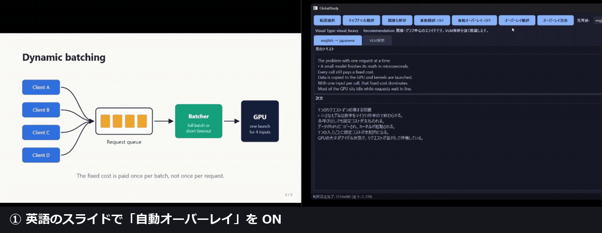

# GlobalStudy

英語の技術動画やスライドを見ながら、画面の文字をその場で日本語にするローカルの学習支援アプリです(Python / PySide6 / RapidOCR / Ollama)。
**画面キャプチャ → OCR → ローカル LLM** を 1 つのホットキーで流し、訳を生成しながら順に表示します。すべて手元の PC で動き、外部の API は使いません。



*自動オーバーレイを ON にすると、範囲の文字を OCR → ローカル LLM で訳し、元の文字の上に重ねる。スライドが変わると検知して訳し直す(切り替わりの一瞬は前の訳が残る)。19 秒、早送りなし。動画は [docs/demo.mp4](docs/demo.mp4)。*

- **何を作ったか**: 範囲を選んで `Ctrl+Shift+Q` を押すと、訳が流れるように出るデスクトップアプリ。元の文字の上に訳を重ねる「オーバーレイ翻訳」、スライドが変わったら自動で訳し直す機能、図の多いスライドを画像ごと説明する VLM 解析もあります。
- **何が分かったか**: 段階ごとに測ったところ、訳の最初の 1 文字が出るまでの約 2 秒は LLM の処理ではなく、`localhost` が IPv6 を先に試して約 2 秒待つことが原因でした。`127.0.0.1` に変えて、**最初の 1 文字までが 2,059 → 16 ms、訳の全文が 2.9 → 0.8 秒**になりました([測定](#測定))。
- **どう動かすか**: [セットアップ](#セットアップ) と [使い方](#使い方)。Ollama と、モデル 2 つ(`qwen3:8b`、`minicpm-v:8b`)が必要です。

## できること

| 機能 | 操作 | 中身 |
|---|---|---|
| 範囲選択 | 「範囲選択」→ ドラッグ | 選んだ範囲は `data/region.json` に保存し、次回の起動時に戻す |
| キャプチャ & 翻訳 | 「キャプチャ＆翻訳」または `Ctrl+Shift+Q` | mss → RapidOCR → `qwen3:8b` でストリーミング翻訳。原文と訳文を並べて表示 |
| オーバーレイ翻訳 | 「オーバーレイ翻訳」 | OCR の行の座標に、訳を重ねて表示する。行ごとに番号を付けて 1 回でまとめて訳し、訳が確定した行から表示する。背景色を周りから取り、文字色を白か黒に決める。同じ行は訳をキャッシュする |
| 自動翻訳 / 自動オーバーレイ | トグル | 1.5 秒ごとに範囲の dHash(64bit)を取り、2 回続けて変わったら訳し直す(アニメーションの途中で訳さないため) |
| スライド判定 + VLM 解析 | 「画像も解析」 | OpenCV で文字の面積・色の面積・直線の数を測り、`TEXT_ONLY` / `MIXED_SLIDE` / `VISUAL_HEAVY` に分ける。図があるときだけ、`minicpm-v:8b` に画像を渡して図の意味を説明させる |
| 言語の切り替え | ドロップダウン | 元の言語 7 種類、訳す先 7 種類。OCR の言語も合わせて切り替える |

## 設計

```
ui/ (PySide6、QThreadPool + Worker)      ← 画面とスレッドの管理だけ
  └→ services/   キャプチャ・OCR・AI・オーバーレイ・VLM の各ユースケース
        ├→ capture/  mss、ホットキー(pynput)、スライド変化の監視(dHash)
        ├→ ocr/      OcrEngine(抽象) ← RapidOcrEngine / PaddleOcrEngine
        ├→ ai/       BaseOllamaClient ← OllamaClient / VlmClient、プロンプト
        └→ visual/   OpenCV によるスライド判定
config/settings.py  すべての設定(frozen dataclass)。ほかのファイルに値を直書きしない
```

- `ui` は `services` だけを呼び、OCR エンジンや LLM には直接触らない。OCR エンジンと LLM クライアントは、コンストラクタで差し替えられる。
- LLM の応答はストリーミングで受け、Qt のシグナルで UI に 1 チャンクずつ渡す。重い処理は別スレッドで動かし、画面は止まらない。
- オーバーレイを出したままキャプチャすると訳自体が写り込むので、いったん隠し、200 ms 待ってから撮る。訳している間に画面が変わっていたら、訳し直す(連続 3 回まで)。
- 詳しい図は [docs/architecture.md](docs/architecture.md)(Phase 7 の時点のもの。オーバーレイと VLM は、この README の表のほうが新しい)。

## 測定

`tools/bench_pipeline.py` で、アプリと同じサービスを GUI なしで呼び、段階ごとの時間を測った。入力は、スクリプトが描くテスト用のスライド(1280x720、英語 6 行、正解の文字列が分かっている)。各条件 5 回の中央値。cold はモデルを VRAM から外した直後の 1 回。

環境: Ryzen 7 9800X3D / RTX 5070 Ti 16GB(ドライバ 610.88)/ Windows 11 / Ollama 0.40.14。3 つのモデルはすべて GPU に載った(`ollama ps` で 100% GPU)。

| 段階 | 修正前(`localhost`) | 修正後(`127.0.0.1`) |
|---|---:|---:|
| キャプチャ(mss + PNG 保存) | 32 ms | 33 ms |
| OCR(RapidOCR、2 回目以降) | 189 ms | 167 ms |
| 翻訳 `qwen3:8b`: 最初の 1 文字まで | 2,059 ms | **16 ms** |
| 翻訳 `qwen3:8b`: 全文 | 2,869 ms | **807 ms** |
| オーバーレイ(当時の既定 `qwen3:1.7b`): 最初のパッチまで(OCR 込み) | 2,283 ms | **230 ms** |
| オーバーレイ: 全 6 行(OCR 込み) | 2,596 ms | **569 ms** |
| 翻訳 cold(モデルの読み込み込み): 全文 | 52.9 s | 2.5 s |

- OCR の精度: テスト用スライドでは 6 行すべてが正解と一致した(文字の一致率 1.000、平均信頼度 0.993)。きれいな画像なので、実際の動画(圧縮のノイズ、小さい文字)ではこれより下がるはず。未測定。
- VLM `minicpm-v:8b`: cold 31 s、2 回目以降は 0.3〜0.8 s。

### 2 秒の正体(`localhost` と IPv6)

Ollama の応答に入っている内訳では、翻訳 1 回は「読み込み 3 ms + プロンプトの処理 8 ms(332 トークン)+ 生成 806 ms(107 トークン)」で、合わせて約 0.8 秒だった。それなのに、アプリ側で最初のチャンクが届くのは約 2.0 秒後。差の約 2 秒は、Ollama に届く前に消えていた。

| 確かめたこと | 結果 |
|---|---|
| `GET http://localhost:11434/api/version` | 毎回 約 2,020 ms |
| `GET http://127.0.0.1:11434/api/version` | 毎回 約 1 ms |
| `getaddrinfo("localhost")` | `::1`(IPv6)が先、`127.0.0.1` が後 |
| `::1` への接続 | 約 2,047 ms 後に拒否 |
| Ollama の待ち受け(`netstat`) | `127.0.0.1:11434` のみ(IPv6 では待ち受けていない) |

つまり、リクエストのたびに、まず IPv6 の `::1` に接続しに行き、拒否されるまで約 2 秒待ってから IPv4 に切り替わっていた。翻訳だけでなく、起動時や VLM の前に行う「Ollama が使えるか」の確認(`is_available()`、1 回ごとに HTTP 1 回)も、毎回 2 秒待っていたことになる。`config/settings.py` の `base_url` を `http://127.0.0.1:11434` にして解消した。結果の生データは [docs/bench/](docs/bench/)。

### まだ分かっていないこと

- **cold の 52.9 s → 2.5 s は、IPv6 だけでは説明できない。** 1 回目は、モデル(5.2GB)を初めてディスクから読んだためで、2 回目は OS のファイルキャッシュに載っていた可能性が高い。キャッシュを消して測り直していないので、切り分けはできていない。
- 実際の動画の画面での OCR の精度と、キャプチャから訳が出終わるまでの、端から端までの時間(GUI を通した時間)は、まだ測っていない。

## 制限・未実装

- **用語解説・重要ポイントは、今の画面では出ない。** 以前は 1 回の問い合わせで「訳・重要ポイント・用語・初心者向けの説明」を出していたが、速さを優先して、訳だけに絞った。図の説明は VLM 解析が受け持つ。
- **学習履歴(SQLite)は未実装。** `config` に DB のパスだけがある。
- VLM の出力が安定しない。プロンプトでは 5 項目を求めているが、1 段落だけ返すことがあり、長さも 53〜212 文字とばらつく。誤訳もある(例: kernel launch を「内核カーネル」)。
- スライド判定の閾値は暫定値で、実際のスライドでは調整していない。デモ用スライド([docs/demo_slides/](docs/demo_slides/index.html))で試すと、文字だけのスライドが `visual_heavy` になった。文字の行そのものが Hough 変換で「直線」として数えられ(143 本。閾値は 20 本)、余白が多いので文字の面積の比率も小さく出る(0.10)。
- オーバーレイ翻訳は、以前の既定だった `qwen3:1.7b` では速いが訳の質が低かった。デモ用スライドの 5 枚では、1 枚が中国語で返ってきた。ほかにも、崩れた語(Median latency →「マジッドラテンス」)や、残すはずのコードの翻訳があった。`qwen3:8b` にすると、5 枚とも日本語で、コードもそのまま残った。そのかわり、1 枚あたり 0.6〜1.0 秒が 0.9〜1.8 秒になった(RTX 5070 Ti)。質を優先して、既定を 8b にした。行ごとに訳すので、文が 2 行に分かれると訳が崩れやすい。
- 単体テストは、LLM と画面に依存しない部分(オーバーレイの行の判定と応答の解析、dHash、設定)だけ。`tests/manual_prompt_check.py` は、今はない関数を読み込むので動かない(以前の版の確認用)。
- Windows で確認。ほかの OS では試していない。

## セットアップ

Python 3.12 と [Ollama](https://ollama.com/) が必要です。

```powershell
python -m venv .venv
.venv\Scripts\Activate.ps1
pip install -r requirements.txt
pip install -e .

ollama pull qwen3:8b       # キャプチャ＆翻訳、オーバーレイ翻訳
ollama pull minicpm-v:8b   # VLM 解析(なくても、翻訳は動く)
```

GPU のメモリが少ない場合、`qwen3:8b`(約 5.6GB)が GPU に入りきらず、一部を CPU で動かすため遅くなります(6GB の GPU では、初回が約 76 秒だった)。`config/settings.py` でモデルを小さくできます(オーバーレイだけ `qwen3:1.7b` にすると速くなるが、訳の質は下がる)。

## 使い方

```powershell
python -m globalstudy.main
```

1. 「範囲選択」で、動画やスライドの部分をドラッグする。
2. `Ctrl+Shift+Q`(または「キャプチャ＆翻訳」)。原文と訳文が表示される。
3. 元の位置に訳を重ねたいときは「オーバーレイ翻訳」。スライドが進むたびに訳したいときは、自動のトグルを ON にする。

測定とテスト:

```powershell
python -X utf8 tools\bench_pipeline.py 5   # 段階ごとの時間(Ollama が必要)
python -m pytest                           # 単体テスト(Ollama は不要)
```

## ライセンス

[MIT](LICENSE)
