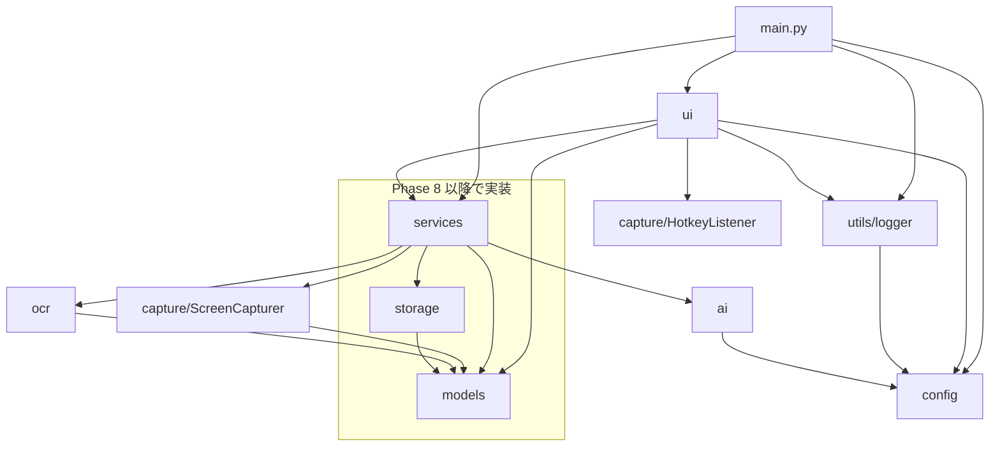
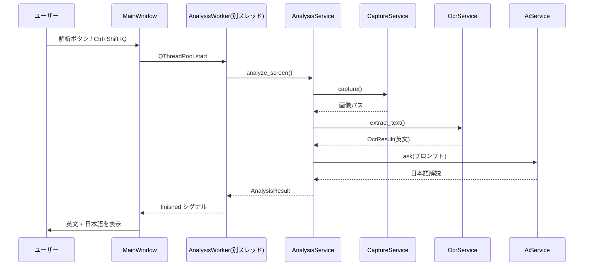
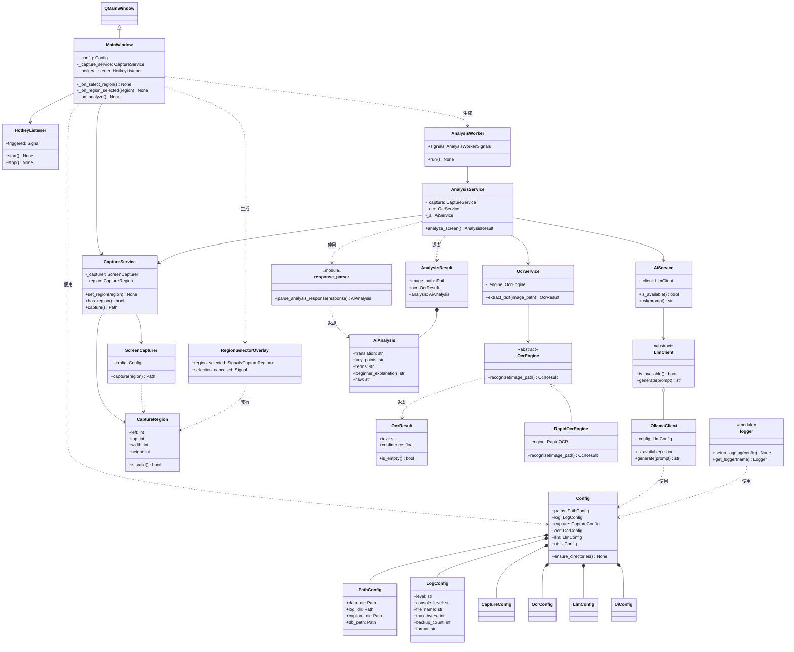

# GlobalStudy アーキテクチャ

最終更新: Phase 7 完了時点

## モジュール依存図

依存ルール:

- `ui` は `services` のみを呼ぶ（capture/ocr/ai を直接呼ばない）
- `config` と `utils` は全レイヤーから利用可
- `models` はどのレイヤーにも依存しない

## 処理フロー（解析パイプライン）

## クラス図（Phase 7 時点）

## フェーズ履歴

| Phase | 内容 | 状態 |
| --- | --- | --- |
| 0 | 環境構築（Config / Logger / 骨格） | 完了 |
| 1 | GUI 骨格 | 完了 |
| 2 | 画面キャプチャ | 完了 |
| 3 | OCR（RapidOCR 採用） | 完了 |
| 4 | LLM 接続（Ollama / qwen3:8b） | 完了 |
| 5 | OCR→LLM 統合（一連フロー完成） | 完了 |
| 6 | GUI 改善（タブ表示・テーマ適用） | 完了 |
| 7 | AI 品質改善（分野非依存プロンプト・4セクション） | 完了 |
